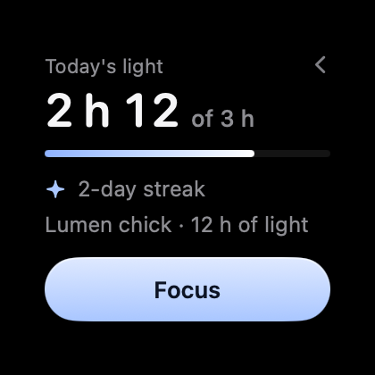
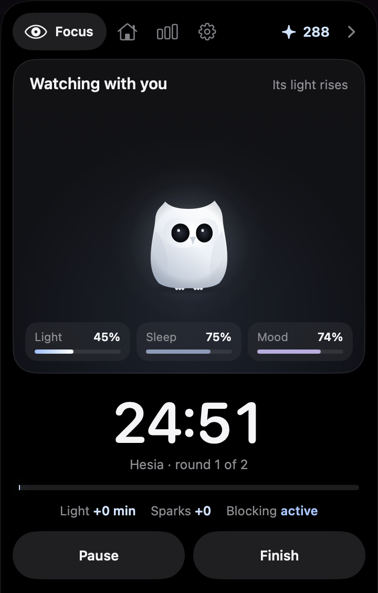
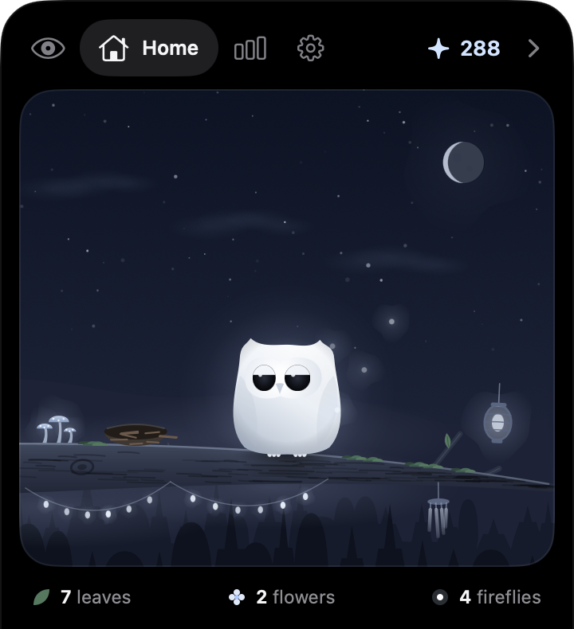

<p align="center"></p>

<h1 align="center">Embery</h1>

<p align="center">Una app de Mac para concentrarse con calma. Vive en el borde de la pantalla y en el notch, sin ventanas que se interpongan: avisa con luz, no con ruido.</p>

<p align="center"><a href="README.md">Read in English</a></p>

<p align="center">
  
  
  
</p>

## Qué hace

- **Foco.** Cronómetro, temporizador o tiempo de uso de una app. Durante el foco puede bloquear apps y webs que distraen.
- **Lumen.** Un búho de luz que crece con las horas de concentración y reacciona a lo que pasa.
- **Paisajes sonoros.** Ambientes sintetizados en la propia app, sin archivos de audio.
- **El Hueco.** El notch se convierte en un panel discreto:
  - volumen y brillo, sin tapar el notch físico;
  - nota rápida con ⌃⌥N, a tu carpeta de notas, a otra carpeta o a la app Notas;
  - el Nido: una bandeja para soltar archivos;
  - aviso si se desconecta el disco donde están tus notas.
- **Tus notas (opcional).** Si eliges una carpeta de Markdown (una bóveda de Obsidian, por ejemplo), Embery enseña las casillas de la nota del día y las notas recientes, y registra ahí las sesiones de foco.
- **Claude Code (opcional).** Si lo usas, el Hueco enseña qué está haciendo cada conversación, te deja contestar los permisos (Permitir/Denegar) sin volver a la terminal, y muestra el uso del plan y los tokens por día. El Scriptorium lo dibuja como una sala con escribientes.

Nada de esto necesita cuenta ni conexión. Los datos se quedan en tu Mac.

La interfaz está en español e inglés y sigue el idioma del sistema.

## Requisitos

- macOS 27 o posterior. El Hueco necesita un Mac con notch.
- Para compilar: Xcode 27, por el SDK de macOS 27. El icono compilado viene en el repo; `actool` solo lo rehace si cambias `Icon/AppIcon.icon`.
- Python 3, solo para la integración con Claude Code.

## Instalar

### Con el DMG

Descarga `Embery-<versión>.dmg` de [Releases](https://github.com/Ivanzu37/embery/releases), ábrelo y arrastra Embery a Aplicaciones.

Embery no está notarizada por Apple, así que la primera vez macOS no la deja abrir. Para permitirla:

1. Intenta abrirla una vez y cierra el aviso.
2. Ve a **Ajustes del Sistema › Privacidad y seguridad**, baja hasta el mensaje sobre Embery y pulsa **Abrir igualmente**.

O, en la Terminal:

```bash
xattr -dr com.apple.quarantine /Applications/Embery.app
```

### Compilándola tú

Con Xcode 27 instalado, un solo comando la compila en tu Mac y la deja en Aplicaciones. Al compilarse aquí, macOS no pone pegas:

```bash
curl -fsSL https://raw.githubusercontent.com/Ivanzu37/embery/main/install.sh | zsh
```

Desde un clon del repo vale `./install.sh`. Para actualizar, repite el comando: cierra la versión abierta y la sustituye.

## Compilar para desarrollar

```bash
./empaquetar.sh          # build/Embery.app, firmada solo para este Mac
open build/Embery.app
tools/dmg.sh             # build/Embery-<versión>.dmg
```

Para pasar los tests:

```bash
swift test
```

## Conectar Claude Code

En Ajustes de Embery, «Avisos y permisos» → **Conectar…**. Embery añade a `~/.claude/settings.json`:

- `embery-hook` en los eventos de Claude Code, para seguir las conversaciones y responder permisos;
- `embery-status` como statusline, si no tienes otra. Es la única vía por la que llegan los límites del plan.

Conecta con la app ya en su sitio (Aplicaciones): los ajustes apuntan a la ruta de la app. Si luego la mueves, vuelve a pulsar **Conectar…** y se corrige sola.

Antes de tocar nada guarda una copia en `settings.json.antes-de-embery`, y solo cambia sus propias entradas. **Quitar** las retira. Si ya tienes una statusline tuya no se pisa: Embery funciona igual, pero sin los límites del plan.

Si Embery está cerrada, los dos scripts salen sin hacer nada y Claude Code sigue como siempre. Ante un permiso, si no contestas en el Hueco en 60 s, la decisión vuelve a la terminal.

## Dónde guarda las cosas

Todo en `~/Library/Application Support/Embery/`: tus datos, el socket local que usan los scripts, el conteo de tokens y el Nido. Para probar sin tocar tu instalación, arranca con otra carpeta:

```bash
EMBERY_DIR=/tmp/embery-prueba open build/Embery.app
```

## Permisos y avisos

- El bloqueo de distracciones y el control de música usan AppleScript: macOS pedirá permiso la primera vez.
- El aviso de brillo lee una API privada del sistema (DisplayServices) que se carga en tiempo de ejecución. Si un macOS futuro la quita, no habrá aviso de brillo y el resto sigue igual.

## Licencia

[MIT](LICENSE).
