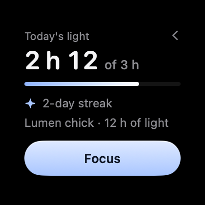
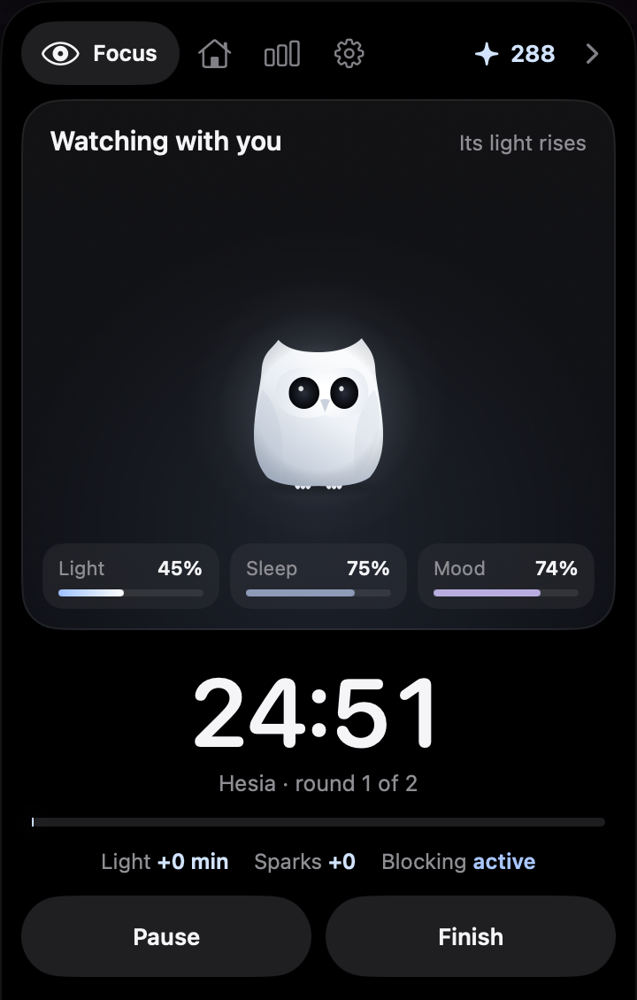
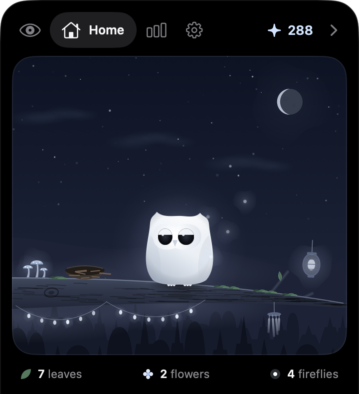

<p align="center"></p>

<h1 align="center">Embery</h1>

<p align="center">A calm focus app for the Mac. It lives on the edge of your screen and in the notch, with no windows in your way: it nudges you with light, not noise.</p>

<p align="center"><a href="README.es.md">Leer en español</a></p>

<p align="center">
  
  
  
</p>

## What it does

- **Focus.** Stopwatch, timer, or time spent in one app. While you focus, it can block distracting apps and sites.
- **Lumen.** An owl made of light that grows with your hours of focus and reacts to what happens.
- **Soundscapes.** Ambient sound synthesized inside the app, with no audio files.
- **The Nook.** The notch turns into a quiet panel:
  - volume and brightness, without covering the physical notch;
  - a quick note with ⌃⌥N, saved to your notes folder, another folder or the Notes app;
  - the Nest: a tray to drop files on;
  - a warning if the disk holding your notes is disconnected.
- **Your notes (optional).** Pick a Markdown folder (an Obsidian vault, for example) and Embery shows today's checkboxes and recent notes, and logs your focus sessions there.
- **Claude Code (optional).** If you use it, the Nook shows what each conversation is doing, lets you answer permission requests (Allow/Deny) without going back to the terminal, and shows plan usage and tokens per day. The Scriptorium draws it as a room of scribes.

None of this needs an account or a connection. Your data stays on your Mac.

The interface is in English and Spanish and follows your system language.

## Requirements

- macOS 27 or later. The Nook needs a Mac with a notch.
- To build: Xcode 27, for the macOS 27 SDK. The compiled icon ships in the repo; `actool` only rebuilds it if you change `Icon/AppIcon.icon`.
- Python 3, only for the Claude Code integration.

## Install

### From the DMG

Download `Embery-<version>.dmg` from [Releases](https://github.com/Ivanzu37/embery/releases), open it and drag Embery to Applications.

Embery is not notarized by Apple, so macOS won't open it the first time. To allow it:

1. Try to open it once and close the warning.
2. Go to **System Settings › Privacy & Security**, scroll to the message about Embery and click **Open Anyway**.

Or, in Terminal:

```bash
xattr -dr com.apple.quarantine /Applications/Embery.app
```

### Build it yourself

With Xcode 27 installed, one command builds it on your Mac and puts it in Applications. Since it's built locally, macOS doesn't complain:

```bash
curl -fsSL https://raw.githubusercontent.com/Ivanzu37/embery/main/install.sh | zsh
```

From a clone of the repo, `./install.sh` does the same.

### Updates

From 0.2 on, Embery updates itself: **Settings › General › Check for Updates…**, or the same item in the ✦ menu. It also checks once a week on its own, without interrupting you (you can turn that off right there). Each update is signed, and Embery won't install one that isn't. Coming from 0.1, install 0.2 by hand once.

## Development

```bash
./empaquetar.sh          # build/Embery.app, signed for this Mac only
open build/Embery.app
tools/dmg.sh             # build/Embery-<version>.dmg
```

To run the tests:

```bash
swift test
```

## Connecting Claude Code

In Embery's Settings, under "Alerts and permissions", click **Connect…**. Embery adds to `~/.claude/settings.json`:

- `embery-hook` on Claude Code's events, to follow conversations and answer permission requests;
- `embery-status` as the statusline, if you don't have one already. It's how plan limits reach Embery while you work in the terminal.

Connect once the app is in its final place (Applications): the settings point to the app's path. If you move it later, click **Connect…** again and it fixes itself.

Before changing anything it saves a copy to `settings.json.before-embery`, and it only touches its own entries. **Remove** takes them out again. If you already have your own statusline it is left alone: Embery works the same, just without plan limits.

If you mostly use Claude desktop, the statusline never runs. Turn on **Ask Claude for usage** (Settings, The Nook): at most every 15 minutes, and only while you're active, Embery sends Haiku a one-word question and reads the limits from the reply. Each one costs a few thousand tokens of your plan.

Another app can listen to the same events: put a link to its Unix socket in `~/Library/Application Support/Embery/forward/` and both scripts send it a copy.

If Embery is closed, both scripts exit without doing anything and Claude Code carries on as usual. If you don't answer a permission request in the Nook within 60 s, the decision goes back to the terminal.

## Where it keeps things

Everything lives in `~/Library/Application Support/Embery/`: your data, the local socket the scripts use, the token count and the Nest. To try it without touching your install, start it with another folder:

```bash
EMBERY_DIR=/tmp/embery-test open build/Embery.app
```

## Permissions and caveats

- Distraction blocking and music controls use AppleScript: macOS will ask for permission the first time.
- The brightness indicator reads a private system API (DisplayServices) loaded at runtime. If a future macOS removes it, there's no brightness indicator and everything else keeps working.

## Uninstall

1. In Settings, click **Remove** next to Claude Code, so `settings.json` stops pointing at the app.
2. Turn off **Open at login** if you turned it on.
3. Quit Embery and move it to the Trash.
4. To erase your data too, delete `~/Library/Application Support/Embery/`. Notes written to your vault stay there.

## License

[MIT](LICENSE).
